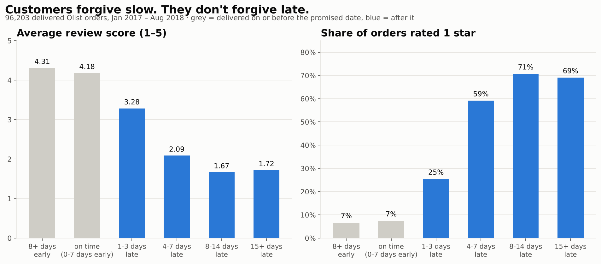
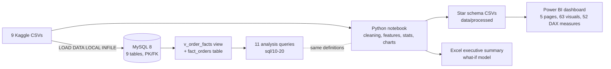
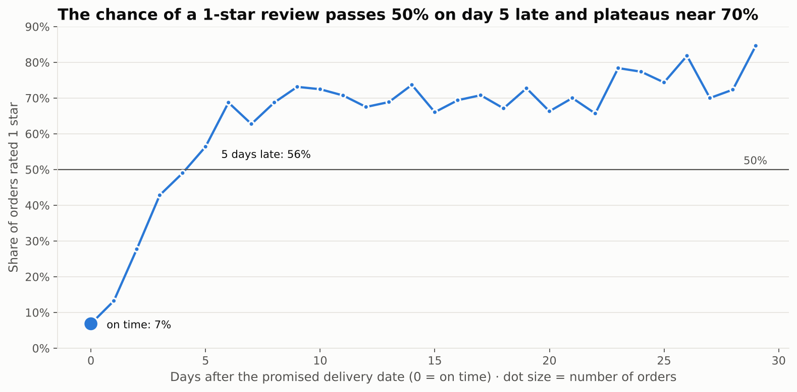
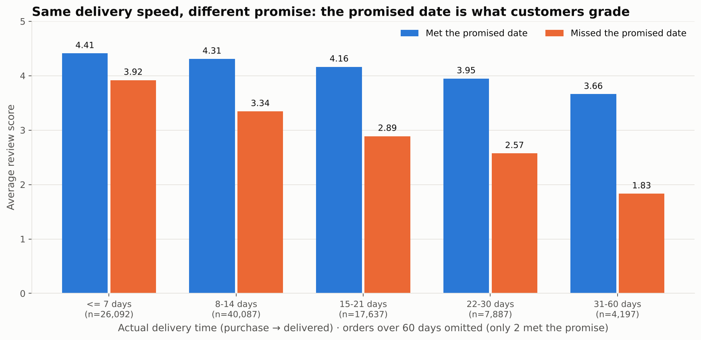
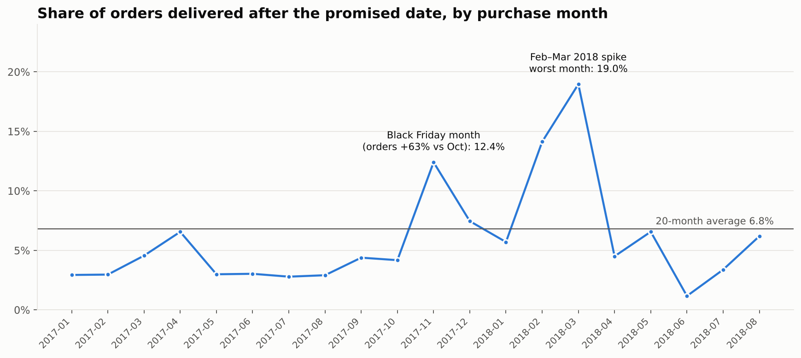
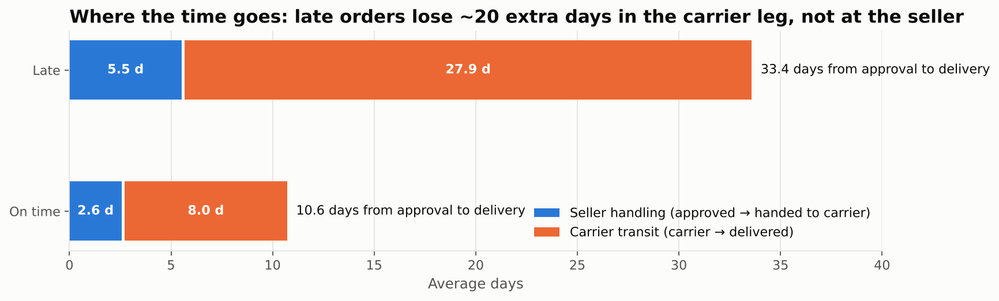
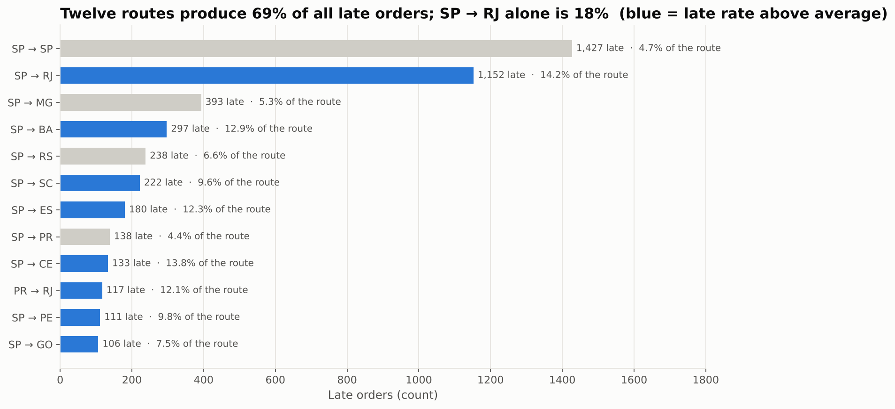
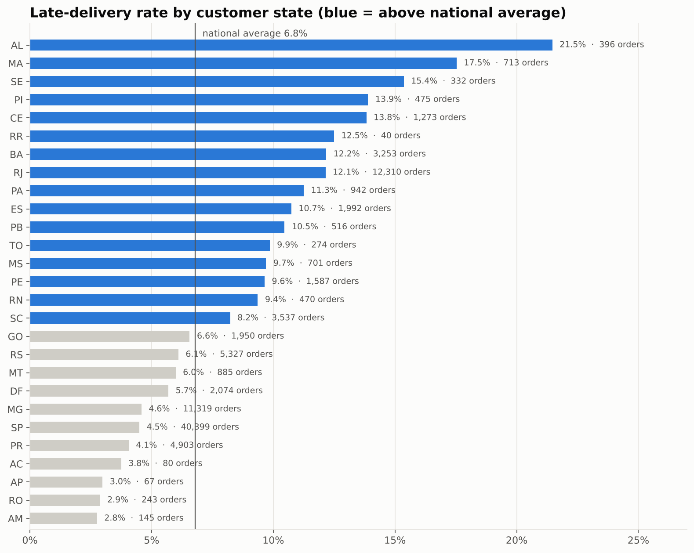
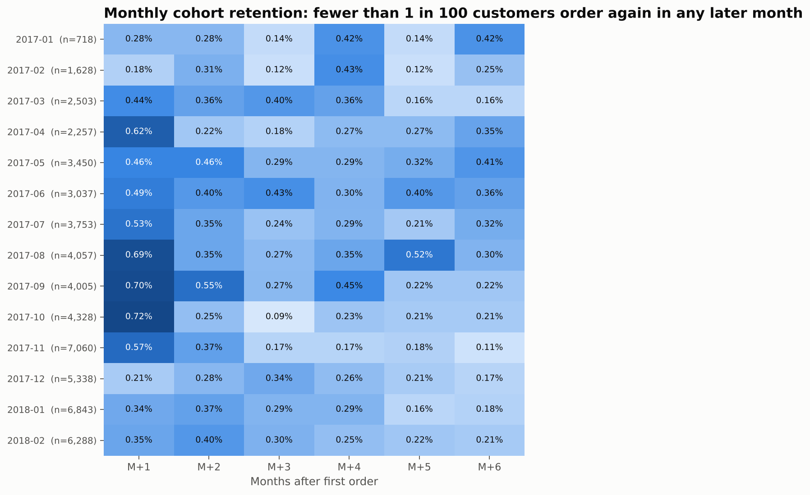
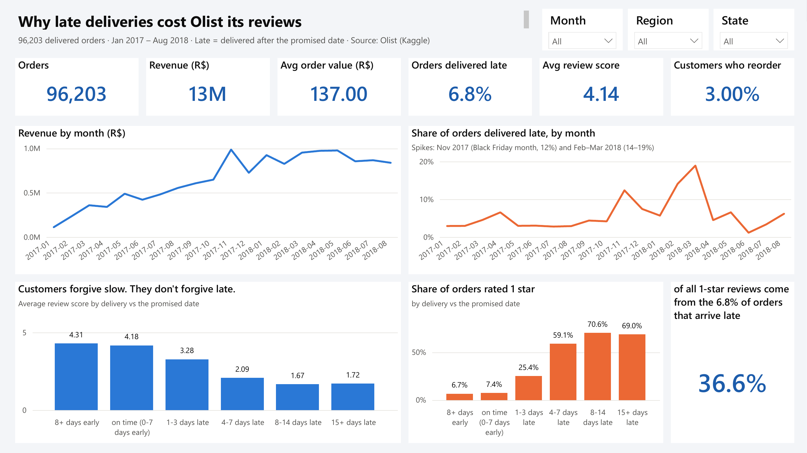

# Why 97% of Olist customers never come back — and what actually drives 1-star reviews

**An end-to-end analysis of 96,203 Brazilian e-commerce orders in MySQL, Python, Power BI and Excel — ending in a costed recommendation.**

`MySQL 8` · `Python (pandas, matplotlib)` · `Power BI (5-page dashboard, star schema, 52 DAX measures)` · `Excel (what-if model)`



---

## TL;DR

| # | Finding | Evidence |
|---|---|---|
| 1 | **Late delivery is the single biggest driver of bad reviews.** | 6.8% of orders arrive after the promised date, but they produce **37% of all 1-star reviews**. Average score 4.28 on time vs **2.26** late. One to three days late already drops it to 3.28; at 4–7 days late **59% of orders get 1 star**. |
| 2 | **Customers grade the promise, not the speed.** | A 22–30 day delivery that met its promise scores **3.95**; the same speed that missed it scores **2.57**. The estimate is padded by ~12 days on average yet still misses on specific routes — it is uniform, not route-aware. |
| 3 | **Lateness is concentrated.** | 12 seller→customer routes produce **69%** of late orders (SP→RJ alone 18%, with a 14% late rate). It spikes in Nov 2017 (12%) and Feb–Mar 2018 (14–19%). In **72%** of late orders the seller shipped on time — the carrier leg is where ~20 extra days are lost. |
| 4 | **Multi-item orders are a second, separate problem.** | Orders with 2+ items get 1 star **2.5×** as often (21.7% vs 8.7%); orders split across 2+ sellers **36.1%** — even though they are *less* often late. Consistent with split/partial deliveries. |
| 5 | **Retention is structural, not a delivery problem.** | **97.0%** of customers never reorder, whatever happened on the first order. A late first order lowers the repeat rate from 3.03% to 2.52% — real, but small. The first order's review score does not predict a second purchase at all. |

**Recommendation (cheapest first):**
1. **Make the delivery promise route-aware.** A 7-day buffer on the 12 worst routes alone would have turned **40% of all late orders into on-time ones** (≈730 fewer 1-star reviews a year); extended to the Nov–Mar peak on every route, 49%; applied everywhere, 56% (≈1,040 fewer). Zero logistics cost — A/B test it against conversion.
2. **Carrier SLA on deliveries to Rio de Janeiro and the nine Northeast states** — 22% of orders but 40% of late ones (12.4% late rate vs 4.5% in São Paulo).
3. **Investigate split deliveries on multi-item orders** (1-star reviews 2.5× as often as single-item orders, 4.1× for multi-seller orders — even though they are late less often).
4. **Stop treating delivery as a retention lever.** Measure it on review score and 1-star rate; retention needs a different lever.

The what-if model in [`excel/olist_executive_summary.xlsx`](excel/olist_executive_summary.xlsx) lets a manager change the target late share or the promise buffer and see reviews avoided and the platform's average score move.

---

## The business question

Olist is a Brazilian marketplace that connects small sellers to large online stores. The public dataset (Kaggle) covers ~100k orders from 2016–2018 with order status, prices, payments, freight, customer location, product attributes and the review each customer left.

> **Is it product, price or delivery that hurts the customer experience most — and what is the single cheapest fix?**

The hypothesis I started with was *"late deliveries are why customers never come back."* Half of it survived: late deliveries are the main driver of 1-star reviews, but they barely move retention, because almost nobody comes back regardless. Both halves are in the findings; I did not keep the hypothesis that the data rejected.

## Data

Brazilian E-Commerce Public Dataset by Olist — [kaggle.com/datasets/olistbr/brazilian-ecommerce](https://www.kaggle.com/datasets/olistbr/brazilian-ecommerce) (CC BY-NC-SA 4.0). Nine relational CSV files: orders, order items, payments, reviews, customers, sellers, products, geolocation (1M rows), category translation.

**Analysis population:** orders with status `delivered`, a delivery date, purchased 1 Jan 2017 – 31 Aug 2018 (20 complete months) → **96,203 orders, 93,096 customers, R$13.18M in item revenue**.

**Data-quality issues found and handled** (`sql/03_data_quality_checks.sql`):

| Issue | Count | Treatment |
|---|---|---|
| Orders not delivered (shipped, cancelled, unavailable…) | 2,963 | excluded — delivery can't be judged |
| Status `delivered` but no delivery date | 8 | excluded |
| `review_id` reused across different orders | 802 ids (827 extra rows) | composite key (review_id, order_id) |
| Orders with two reviews | 555 | latest review kept |
| Products with no category | 610 | labelled `unknown` |
| Category names with no English translation | 2 | Portuguese name kept |
| Review texts with embedded line breaks and CRLF endings | 4,000+ | handled in `LOAD DATA` with `ENCLOSED BY '"'`, CR stripped |
| Sep–Dec 2016 and Sep–Oct 2018 have < 350 orders | — | analysis window restricted to 20 full months |

## Pipeline



Every definition (late, delay days, revenue, review score) is written once in the SQL view and reproduced identically in pandas, so the numbers in the SQL outputs, the notebook, the dashboard and the workbook agree to the decimal.

## Findings in detail

### 1. A missed promise turns a 4.3-star experience into a 1-star one
`sql/12_review_score_vs_delay.sql` · `sql/20_headline_numbers.sql`

| Delivery vs promise | Orders | % of orders | Avg score | % 1-star |
|---|---:|---:|---:|---:|
| 8+ days early | 71,046 | 73.9% | 4.31 | 6.7% |
| On time (0–7 days early) | 18,626 | 19.4% | 4.18 | 7.4% |
| 1–3 days late | 1,869 | 1.9% | 3.28 | 25.4% |
| 4–7 days late | 1,802 | 1.9% | 2.09 | 59.1% |
| 8–14 days late | 1,478 | 1.5% | 1.67 | 70.6% |
| 15+ days late | 1,382 | 1.4% | 1.72 | 69.0% |



### 2. Customers grade the promise, not the speed
`sql/13_promise_vs_speed.sql`



Read across any column: same delivery time, 0.5–1.8 stars of difference depending on whether the promised date was met. Olist's estimate is generous (orders arrive 11.8 days early on average) but it is the *same* generosity everywhere, so it fails exactly where transit is slow.

### 3. Lateness is concentrated — in time, in space, and in the carrier leg
`sql/10_monthly_trend.sql` · `sql/11_delivery_by_state.sql` · `sql/14_delivery_stages.sql` · `sql/15_late_routes.sql`









### 4. Multi-item and multi-seller orders
`notebooks/olist_analysis.ipynb` §9

Splitting the 96,203 orders by what they contain:

| Order type | Orders | Late | 1-star reviews | 1-star, on-time orders only | 1-star, late orders only |
|---|---:|---:|---:|---:|---:|
| Single item | 86,598 | 7.0% | 8.7% | 5.4% | 53.8% |
| 2+ items | 9,605 | 5.3% | **21.7%** (2.5×) | 19.6% | 58.7% |
| …of which 2+ sellers | 1,272 | 1.0% | **36.1%** (4.1×) | 35.7% | 69.2% |

Multi-item orders are *less* often late, yet get far more 1-star reviews — and the gap is there among on-time orders too, so it is not lateness in disguise. This was not part of the original hypothesis; the most likely explanation is split or partial deliveries.

### 5. Retention is structural
`sql/17_repeat_purchase.sql` · `sql/18_cohort_retention.sql`



| First order was… | Customers | Repeat rate |
|---|---:|---:|
| on time | 86,744 | 3.03% |
| late | 6,352 | 2.52% |

Repeat rate by first-order review score: 2.9% (1 star) · 2.8% · 3.0% · 2.7% · 3.1% (5 stars) — flat.

## Sizing the fix

| Lever | Input | Result per year |
|---|---|---|
| **A. Carrier fix** — cut late share from 6.8% to 3.5% | operational cost unknown | 1,898 orders moved on time → **≈ 900 fewer 1-star reviews**, platform average score 4.14 → 4.21 |
| **B. Route-aware promise** — +7 days on the 12 worst routes | zero logistics cost | 40% of late orders rescued → **≈ 730 fewer 1-star reviews**, late share 6.8% → 4.1%. Routes + Nov–Mar: 49% / ≈ 900. Everywhere: 56% / ≈ 1,040 |

Both are live formulas in the Excel workbook (change the yellow cells: target late share, buffer days, scope). Lever B assumes a late order that falls inside a longer promise behaves like an on-time one — supported by finding 2, but correlational, hence the A/B test.

## The dashboard

Five pages in Power BI, one question per page. Every number on them reconciles to the SQL layer (same definitions, same 96,203 orders).



| Page | Question | What's on it |
|---|---|---|
| 1 · Overview | What's the one problem to care about? | KPIs, revenue and late-rate trends, review score and 1-star rate by delivery vs promise |
| 2 · Delivery & Satisfaction | Slow or late — which one do customers punish? | promise-met vs promise-missed by actual delivery time, seller handling vs carrier transit, worst 12 states, region shares |
| 3 · Routes | Where does it happen? | top 12 routes, seller-state × customer-state heat map, top-12-routes vs all-other-routes trend |
| 4 · Sellers & Categories | Who do we call on Monday? | seller watchlist (100+ orders, worst late rate first), revenue by category |
| 5 · Retention | Does fixing delivery bring customers back? | orders per customer, repeat rate by first-order outcome, 2017 cohort heat map |

Star schema (8 tables loaded with Power Query from `data/processed/`), 52 DAX measures, Top-N and measure filters, conditional-formatting heat maps, slicers synced across pages, custom theme. The file is `powerbi/Olist Delivery Dashboard.pbix` — details, the measure list and the expected values in [`powerbi/README.md`](powerbi/README.md); page images and the PDF export in `docs/dashboard_pages/`.

## Limitations, honestly

- Review scores are correlational evidence; I cannot prove the longer promise *causes* better reviews without an experiment.
- Revenue is item price only; Olist's take rate and the cost of a carrier SLA are not in the data, so lever A is sized in reviews, not reais.
- Multi-seller orders are 1.3% of the population — a large effect on a small base.
- Reviews are 1–5 stars with no verified link to a *specific* complaint; the "partial delivery" explanation for finding 4 is an inference from the comments I read, not a measured field.

## Repository

```
olist-retention-delivery-analysis/
├── README.md
├── requirements.txt
├── data/
│   ├── raw/                  9 Kaggle CSVs (git-ignored; download link above)
│   └── processed/            star schema + summary tables exported by the notebook
├── sql/
│   ├── 01_create_schema.sql              tables, keys, constraints
│   ├── 02_load_data.sql                  LOAD DATA LOCAL INFILE for all 9 files
│   ├── 03_data_quality_checks.sql        what's wrong with the data and what I did
│   ├── 04_create_views_and_fact_table.sql v_order_facts view + fact_orders
│   ├── 10_monthly_trend.sql … 20_headline_numbers.sql   11 business questions
│   └── outputs/                          every query's result as CSV
├── notebooks/
│   ├── olist_analysis.ipynb              executed notebook (charts inline)
│   └── olist_analysis.py                 same notebook as a script
├── scripts/
│   ├── load_to_mysql.py                  one-command load from Python
│   ├── run_sql_queries.py                runs sql/10-20 and saves outputs
│   ├── build_excel_summary.py            builds the Excel workbook
│   └── build_memo.py                     builds the one-page memo PDF
├── powerbi/
│   ├── Olist Delivery Dashboard.pbix     open in Power BI Desktop (5 pages, 63 visuals, data included)
│   ├── README.md                         what each page answers, the model, expected values
│   ├── dax_measures.dax                  the 52 measures as text
│   └── theme.json                        report theme
├── excel/olist_executive_summary.xlsx    10 sheets, live what-if model
├── images/                               charts used above
└── docs/
    ├── insights_memo.pdf                 one-page memo for stakeholders
    ├── dashboard_pages/                  PNG of each dashboard page + the 5-page PDF export
    └── posts/                            LinkedIn posts (incl. the dashboard write-up) + TikTok scripts
```

## Reproduce it

1. **Data:** download the Kaggle dataset and unzip the 9 CSVs into `data/raw/`.
2. **MySQL:** `python scripts/load_to_mysql.py --user root --password YOURPASSWORD`
   (or run `sql/01` → `02` → `04` yourself with `mysql --local-infile=1 -u root -p < sql/02_load_data.sql` from the project root).
3. **Queries:** `python scripts/run_sql_queries.py --user root --password YOURPASSWORD` → results land in `sql/outputs/`.
4. **Notebook:** `pip install -r requirements.txt` then open `notebooks/olist_analysis.ipynb` and run all (≈15 s). It writes `data/processed/` and `images/`.
5. **Excel:** `python scripts/build_excel_summary.py`
6. **Power BI:** open `powerbi/Olist Delivery Dashboard.pbix` (the data is inside). To reload from your own `data/processed/`, change the `DataFolder` parameter (Transform data → Edit parameters) and click Refresh — see `powerbi/README.md`.

## About

**Bamidele (Ideraoluwa) Yetunde** — Junior Data Analyst (Excel · Power BI · SQL · Python · Power Query · DAX · data modelling).
LinkedIn: [linkedin.com/in/bamidele-yetunde](https://linkedin.com/in/bamidele-yetunde) · Portfolio: [github.com/bamidele-yetunde](https://github.com/bamidele-yetunde) · Email: ideraoluwaabiona@gmail.com · Open to remote Data Analyst / BI Analyst roles

If you are hiring a junior data analyst who starts from the business question and finishes with a number someone can act on, I'd love to talk.
